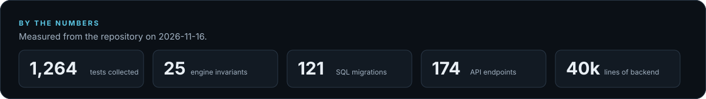
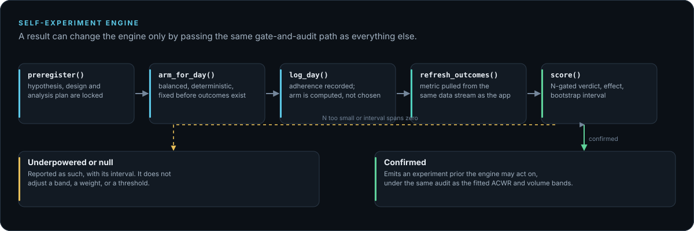
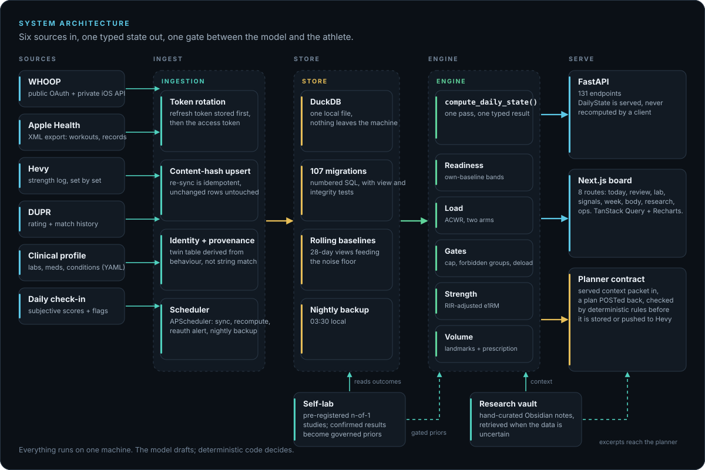
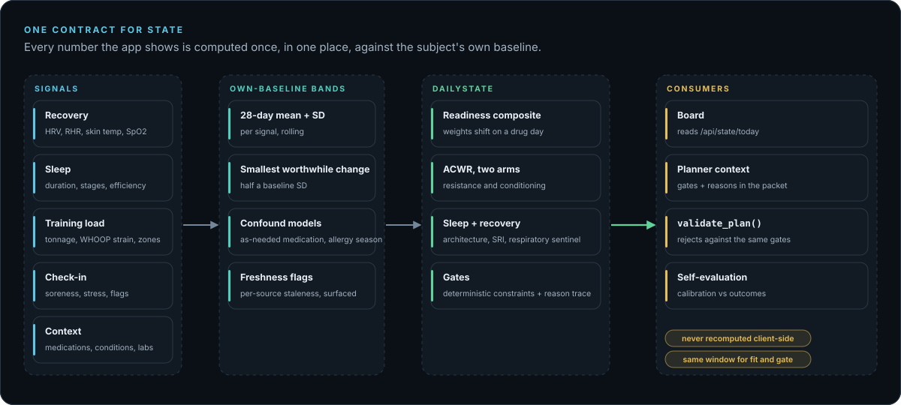
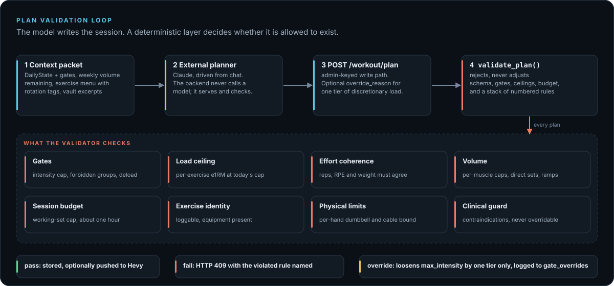
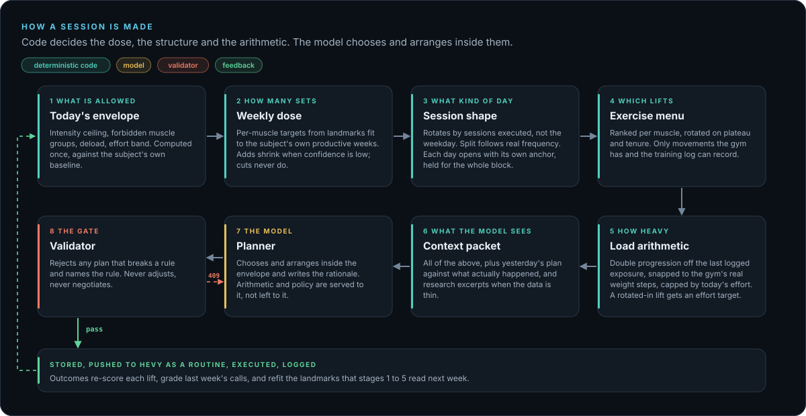
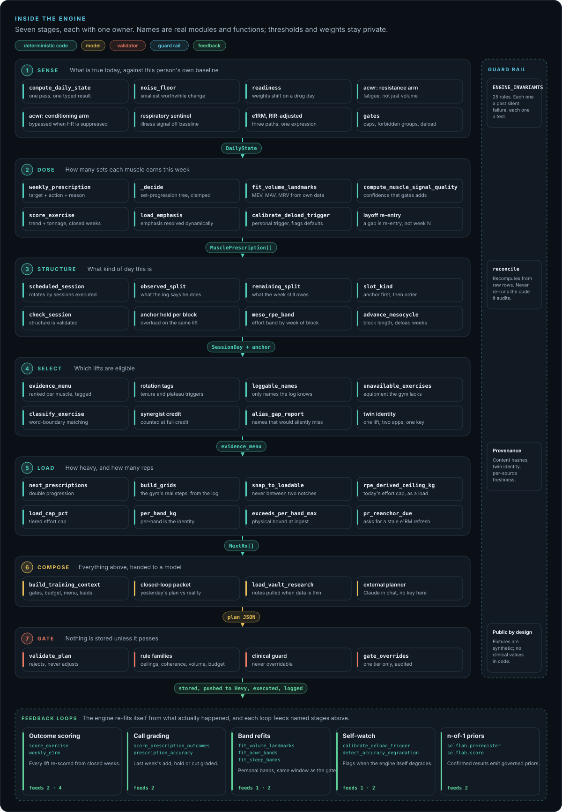

<div align="center">


<br />

### A sports-science lab with a sample size of one.

Wearable physiology, strength logs, blood work, match results and a curated research corpus,<br />
fused every morning into one decision: train or not, how hard, and on what.

<br />

[](https://www.python.org/)
[](https://fastapi.tiangolo.com/)
[](https://duckdb.org/)
[](https://nextjs.org/)
[](https://react.dev/)
[](backend/tests)
[](LICENSE)

**[Methods](#methods)** &nbsp;·&nbsp; **[Architecture](#architecture)** &nbsp;·&nbsp; **[Field notes](#field-notes)** &nbsp;·&nbsp; **[Evaluation](#how-it-is-verified)** &nbsp;·&nbsp; **[Limitations](#what-it-cannot-do-yet)** &nbsp;·&nbsp; **[Docs](#documentation)**

</div>

---

## In thirty seconds

<table>
<tr>
<td width="50%" valign="top">

**N-of-1 by design.** There is one subject and there will never be a cohort. Every metric is banded against the subject's own smallest worthwhile change, never a population norm, and every claim is an effect size with an interval.

</td>
<td width="50%" valign="top">

**A model writes the plan. Code can veto it.** Claude drafts each session. A deterministic validator checks it against recovery, load, volume and clinical gates and returns a 409 with the rule named. The backend holds no model key.

</td>
</tr>
<tr>
<td width="50%" valign="top">

**A research team with a blind reviewer.** Four specialists each keep their own agenda and propose studies as specs, a methodologist approves or rejects them without seeing the proposer's reasoning, a runner re-tests them nightly, and a forecaster is scored against a no-change baseline.

</td>
<td width="50%" valign="top">

**It publishes its own nulls.** Prescription calibration is good. Readiness has no demonstrated predictive validity at n = 54, and that result sits in the README next to the good one.

</td>
</tr>
</table>



---

## Methods

### The constraints that shaped it

**One subject, forever.** A population threshold answers "where does he sit among people?" The only question that matters here is "did this move?" So the system carries its own noise floor, half the subject's baseline SD, and every band on the board is drawn against it. n is small and stays small, which is why results come with intervals and why an underpowered null gets published.

**The output can hurt someone.** A bad recommendation is a torn hamstring or a missed cardiac signal. The model reasons, drafts and explains; it never has final say. Gates are deterministic code with tests, because an instruction in a prompt is a suggestion to a system that is trying to look helpful.

**Consumer sensors, known confounds.** Personal factors can move heart rate, HRV, skin temperature and respiratory rate, which can make a wearable recovery score misleading on the days it matters most. Vendor scores are never displayed as-is. Everything is recomputed from the underlying signals with the confounds modelled explicitly.

**A decade of training in two apps.** History was imported from one logger to another, so the same session exists twice under different names. Deduplication is part of the data model, and exercise identity is derived from behaviour (same day, same set sequence) instead of string similarity.

**One hour, four days a week.** Volume prescriptions have to fit a real budget. The planner publishes weekly set capacity against demand instead of quietly dropping what does not fit.

### A research team that studies one person

The Lab is a handful of roles with separate jobs, and the separation carries the rigour.

| Role | Sees | Does |
|---|---|---|
| **Specialists** (hypertrophy, recovery, conditioning, metabolic) | A brief rebuilt from the database each run: current beliefs, every past question, the forecasts that missed worst | Each explores its own field freely, keeps an agenda, and proposes questions as declarative specs, so a new study needs no new code |
| **Methodologist** | The spec, its power estimate and the data. Never the proposer's reasoning | Approves or rejects, in writing, with a design it would accept |
| **Runner** | Approved specs | Re-tests each one nightly and rebuilds its posterior from scratch, so no day is counted twice |
| **Forecaster** | Only data available before each monthly cut-off | Predicts the next month of mornings and is scored against a zero baseline: no change from the outcome's own baseline |

- **Beliefs start wide and narrow on evidence.** Each prior is taken from the research vault, cited, and deliberately loose. The subject's own results tighten it.
- **Studies are sized before they run.** Power comes from the outcome's own spread and day-to-day carryover. A server-computed value score (uncertainty, decision relevance, feasibility, novelty) orders the queue, so no agent can argue its own question to the top.
- **Beliefs are ablated.** Each one is removed and the forecast re-scored. A belief that makes the forecast worse is marked for demotion, however good its p-value looked.
- **The notebook is append-only.** Proposals, reviews, results and belief changes are never edited, and the specialists read it first.

In its first real cycle, run by the single analyst the specialists later replaced, the lab proposed three studies and the methodologist rejected all three: a circular exposure, an outcome measured in the same recording as its cause, and an unadjusted confounder. Each rejection came with a design it would approve. The same cycle found two bugs in the feature store.

A devil's advocate role exists to challenge a decisive result before it is believed, with its objections committed to the notebook before it sees the result. It is defined but has not yet been exercised on a real result.

### Experiments that cannot move the engine by accident



Passive correlation in one person is cheap and misleading. The experiment engine runs designed single-subject studies: hypothesis and analysis plan are locked before data exists, each day's arm is fixed before outcomes are known, and every statistic is deterministic. Only a confirmed result can emit a prior, and that prior goes through the same audit as the fitted load and volume bands.

---

## Architecture



Sources are pulled on a schedule, normalized, and written idempotently, so a re-sync never rewrites an unchanged row. One engine pass turns the store into a single typed state. The board, the planner's context, the plan validator and the self-evaluation all read that state and none of them recompute it. The research vault and the experiment engine are the only inputs from outside the data path, and both are gated and audited.

### One contract for state



`DailyState` exists because the same metric was once computed three ways in three places and gave three slightly different answers. Readiness, HRV, sleep, load and the day's gates are computed once. The frontend reads `/api/state/today` and infers nothing client-side. Personal-factor adjustments live in the gates object, and components consume them instead of reading the raw profile.

### The model proposes, the validator disposes



The backend serves a context packet, accepts a plan back over an authenticated endpoint, and runs it through `validate_plan()`. A plan that trains legs 30 hours after the last leg session is rejected with the rule named. It is not adjusted, and it is not a warning. The one escape hatch is an explicit `override_reason`: it loosens the discretionary intensity cap by exactly one tier, is audit-logged when it changes the outcome, and cannot touch recovery timing, deload or the clinical guard. [More in ai-integration.md](docs/ai-integration.md)

### How a session is made



Early on the model composed every session from scratch, and that freedom is where the recurring failures lived: hand-computed ceilings, loads between plates, a day renamed and restructured every morning. Behaviour requested in prose never stuck, because each morning's planner starts with no memory of the request. So each decision got one owner in code, and no owner may make another's decision.

- **Dose.** Sets per muscle come from volume landmarks fit to the subject's own productive weeks, scored by outcome trend. A muscle that is measurably progressing is never frozen by low confidence.
- **Structure.** Days rotate by sessions executed, so a missed day does not skip a template. Each day's anchor lift is held for the block so overload shows up on the same movement week over week.
- **Arithmetic.** Double progression off the last logged exposure, snapped to weights the gym can produce, learned from the log. An audit of 25 stored plans found 53 of 144 weighted prescriptions landing between two weights that had ever been used. A lift with no recent history gets an effort target, never an invented number.
- **Feedback.** Executed sessions re-score every lift, grade last week's calls against what happened, and refit the landmarks the next plan reads.

The model keeps selection and arrangement inside that envelope, plus the written rationale. The thresholds behind each stage are deliberately not published here.

<details>
<summary><b>Inside the engine</b>: seven stages, the typed handoff between each, and the loops that refit it</summary>
<br />



Each band is a stage with one owner. The label between bands is the typed object it hands on, the rail on the right keeps every stage honest, and the loops at the bottom are how the engine corrects itself from outcomes. Module names are real; the numbers behind them are not on this page.

</details>

---

## Field notes

Six problems from the build, each one found in production data. Expand any of them.

<details>
<summary><b>Every trial was too small to answer its own question.</b> A 5 ms HRV effect needed ~585 days per arm. The trials asked for 8.</summary>
<br />

Next-morning HRV swings about 25 ms around the subject's own baseline. Eight days per condition can only detect an effect larger than a third of his entire HRV. The tests also treated each day as independent, and HRV carries over from one day to the next: on simulated null data with that carryover, the old test claimed an effect 22.7% of the time at a nominal 10%. After correcting for carryover it is 7.3%. Every trial now shows the days it needs, and "refuted" requires the interval to rule out the hypothesised effect, not a point estimate leaning the wrong way.

</details>

<details>
<summary><b>The engine grades itself, and the result is split.</b> +0.03 RPE bias on 234 prescriptions. Readiness predicts nothing at n = 54.</summary>
<br />

Prescription calibration is good: +0.03 RPE bias over 234 matched prescriptions, 86% within 0.5 of target. Predictive validity is a null: readiness against the session that follows is r = −0.07 on volume-load, every interval spanning zero at n = 54. Both numbers are published, because either alone tells the wrong story. The readiness weights were not retuned on an underpowered result. [More in evaluation.md](docs/evaluation.md)

</details>

<details>
<summary><b>27% of the training history was the same sessions logged twice.</b> An exact join found zero duplicates. Rounding first found twelve thousand.</summary>
<br />

Two apps, one imported from the other, the same set stored as `61.235` and `61.23497000135107` under two exercise names. The deduplication view was catching 1 of 17 real twin pairs. Live decision windows were never affected, which was verified, but the 104-week landmark fit was inflated by up to 57% per muscle. The fix is a normalized canonical key plus an evidence-derived twin table, where every pairing comes from two names appearing on the same day with an identical set sequence. [More in engine.md](docs/engine.md)

</details>

<details>
<summary><b>A language model that cannot overrule the safety layer.</b> Rotation, anchoring and session shape moved from prompt into validators.</summary>
<br />

Claude drafts the session. `validate_plan()` checks it against schema and today's gates: intensity cap, forbidden muscle groups, per-exercise e1RM ceiling, rep windows, RPE coherence. Behaviour that was asked for in prose and never stuck was moved into validators, because a fresh planner each day does not remember a request. [More in ai-integration.md](docs/ai-integration.md)

</details>

<details>
<summary><b>A missing OAuth parameter that looked like "the vendor logs me out daily."</b> Deterministic, not a race.</summary>
<br />

The token endpoint returns a replacement refresh token only when the request carries a `scope` parameter. Without it, every refresh spent the current token and got nothing back, so the connection lasted exactly one access-token lifetime and then died for good. An earlier shutdown fix narrowed the window without closing it, which is what made it look like a race. The rotation hand-off now stores the irreplaceable half first. [More in engine.md](docs/engine.md)

</details>

<details>
<summary><b>The expensive bugs live at the seams.</b> Two correct components that disagree at the boundary, where nothing throws.</summary>
<br />

Exercise selection ranked and rotated correctly, then emitted a name the logging app had never heard of, so the swap did nothing for months. A research panel showed six tiles, two of which had never rendered a value because a bare `except Exception` swallowed a wrong column name. Audits here target the boundaries between components more than the formulas inside them.

</details>

---

## How it is verified

| Layer | What it covers |
|---|---|
| [`ENGINE_INVARIANTS.md`](ENGINE_INVARIANTS.md) | The athlete-protection contract: 25 invariants, each traced to a real defect and enforced by an executable test |
| `validate_plan()` | Schema plus deterministic gates. Rejects; never adjusts |
| Reconciliation | Recomputes from raw rows instead of re-running the code it audits |
| Migrations | 121, with view and data-integrity tests on the ones that change semantics |
| Suite | 1,264 tests, 17.6k test lines against 39.6k lines of backend source |
| Self-evaluation | Calibration and predictive validity, measured and published |
| Research machinery | Planted-effect tests: the spec runner must recover a synthetic effect inside its interval, noise must never read as supported, and no estimate may see data after its own date |

## What it cannot do yet

The honest state of the system. Full list in [evaluation.md](docs/evaluation.md).

- **Readiness has no demonstrated predictive validity** at n = 54, and it still gates training. This is the weakest load-bearing assumption in the engine.
- **The lab barely predicts a single morning.** Forecast skill is +0.1% over 177 held-out mornings. Day-level HRV is mostly noise, so weekly questions are where the research team intends to earn skill.
- **ACWR is a monitoring frame, not an injury model.** Acute and chronic windows are uncoupled, but the evidence for ACWR thresholds predicting injury is contested ([Zouhal et al. 2021](https://doi.org/10.3389/fphys.2021.669687)), and the gates are only as good as that evidence.
- **HRV is confounded** by personal factors and still carries 0.40 of the readiness composite.
- **Two e1RM sources disagree** for the same lift, cause not yet understood.
- **The deload trigger is not personalized** and can return population defaults that look like fitted values.

---

## Documentation

| | |
|---|---|
| [evaluation.md](docs/evaluation.md) | Does it work? Calibration, the null, the noise floor, n-of-1 studies, limitations |
| [engine.md](docs/engine.md) | Metrics, gates, readiness, ACWR, the volume model, exercise intelligence |
| [sports-science.md](docs/sports-science.md) | Sleep architecture, periodization, fueling, clinical signals, the research lab |
| [ai-integration.md](docs/ai-integration.md) | Context assembly, plan generation, running without a model |
| [interface.md](docs/interface.md) | The board, what each surface shows, the design system |
| [vault.md](docs/vault.md) | The curated research corpus and how it reaches the planner |
| [API.md](docs/API.md) | Endpoint reference |
| [DECISIONS.md](DECISIONS.md) | Architecture decision log |
| [CHANGELOG.md](CHANGELOG.md) | What changed, what broke, and what I got wrong |

## Under the hood

- **Backend.** Python 3.12, FastAPI, DuckDB, APScheduler, Pydantic, NumPy. `uv`, `ruff`, `pyright`, `pytest`.
- **Frontend.** Next.js 16, React 19, TypeScript, Tailwind 4, TanStack Query, Recharts, Motion.
- **Reasoning.** Claude as an external planner over a served context packet. An Obsidian vault of peer-reviewed sources as the research corpus.
- **Sources.** WHOOP (public OAuth API, plus the private API for signals the public one omits), Apple Health export, Hevy strength logs, DUPR pickleball rating and matches, a private YAML profile, tape measurements, and a daily check-in.

**Privacy.** One DuckDB file on one machine at home, reached from other devices over a private tailnet. No cloud database, no analytics, no telemetry. `backend/data` is gitignored because this repository is public, and test fixtures are synthetic by construction.

```bash
./dev-restart.sh          # API on :8000, board on :3000
```

Migrations apply on API start. The backend makes no model calls, so every metric, gate and prescription computes on its own. Plan drafting and narrative happen in a chat session that reads the served context and posts the result back.

<br />

<div align="center"><sub>Built by Rob Savage · 607 commits since April 2026</sub></div>
