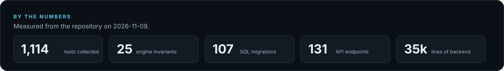
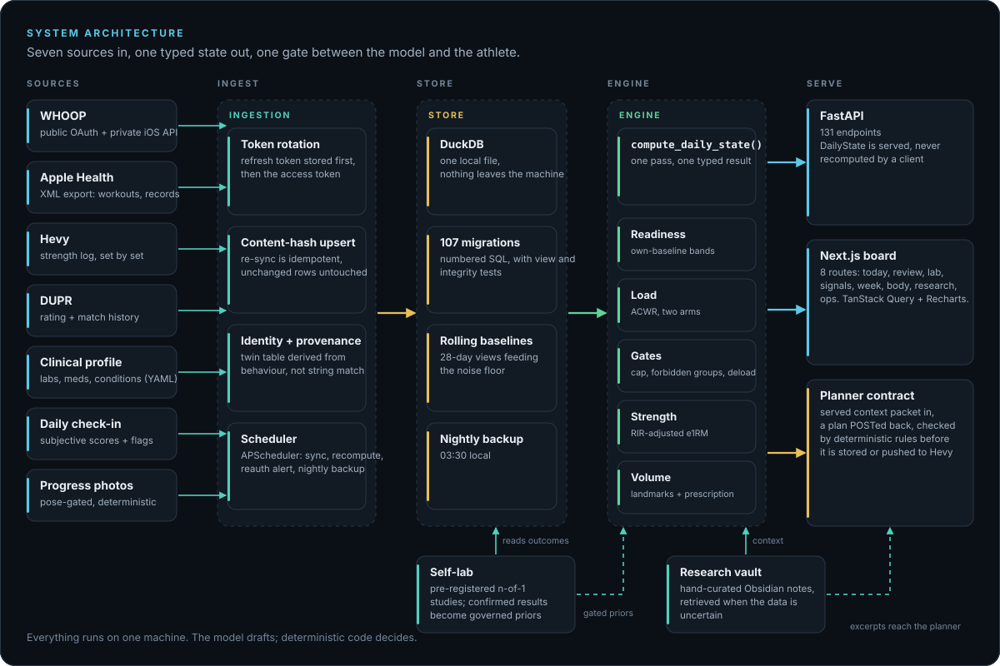
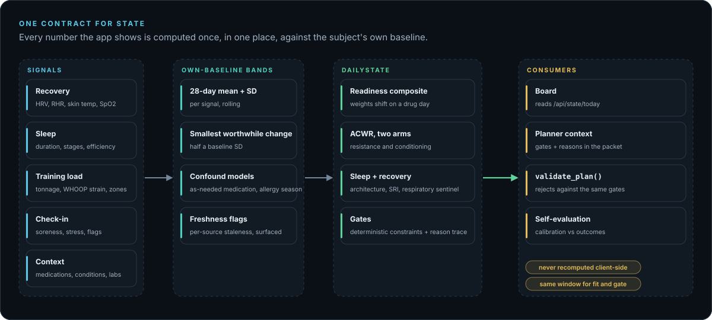
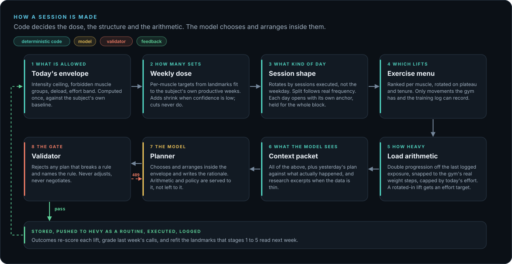
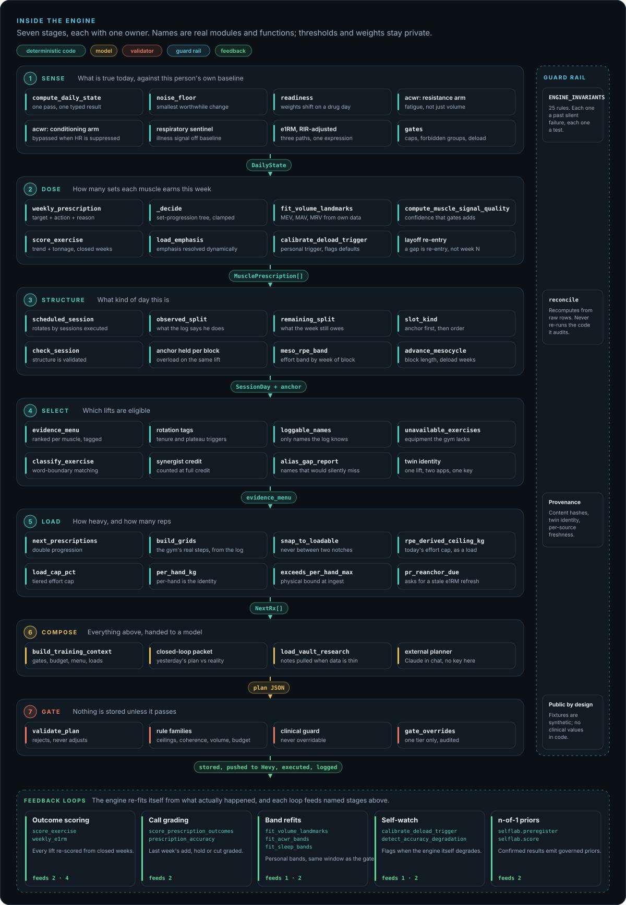
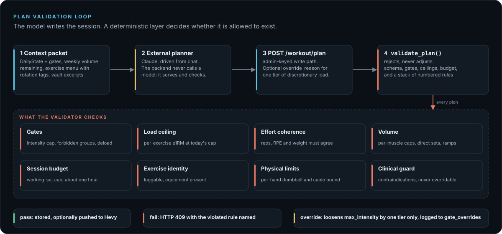
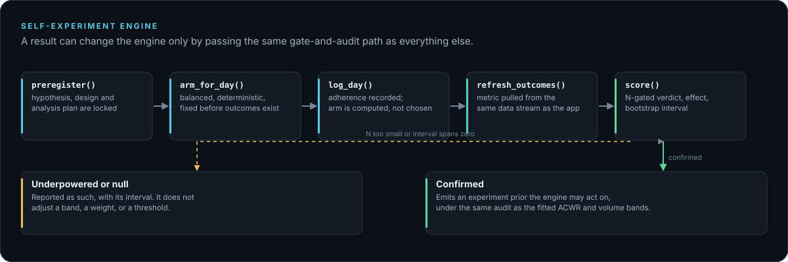

<div align="center">


<br />

**Lab thinking, consumer sensors, daily action.**

<sub>Wearable physiology, training logs, subjective context, progress photos, sport outcomes, research priors, and deterministic gates, fused into one decision, every morning.</sub>

<br /><br />

[](https://www.python.org/)
[](https://fastapi.tiangolo.com/)
[](https://duckdb.org/)
[](https://nextjs.org/)
[](https://react.dev/)
[](https://www.typescriptlang.org/)
[](LICENSE)

</div>

---

## What This Is

Savage Labs fuses wearable physiology, training logs, blood work, subjective
check-ins, and a hand-curated research corpus into one decision every morning:
train or do not, how hard, and on what. It runs entirely on one machine, for one
person. Nothing leaves the laptop.

The interesting part is not the dashboard. It is that a language model writes the
training plan and a deterministic layer is allowed to reject it.



---

## The Constraints That Forced the Design

Every design choice below follows from one of these. None of them are
preferences.

**One subject, forever.** There is no cohort and never will be. A population
threshold answers "where does he sit among people?" when the only question that
matters is "did this move?" So the system carries its own noise floor, derived
from the subject's own baseline SD, and bands every metric against that instead
of against published norms. It also means n is small and permanently small,
which is why results get reported with intervals and why an underpowered null
is published rather than buried.

**The output can hurt someone.** A bad recommendation is a torn hamstring or a
missed cardiac signal, not a bad movie night. So the model never has final say.
It reasons, drafts, and explains. A separate layer checks the draft against hard
gates and rejects it outright, without negotiating. Gates are deterministic code
with tests, not prompt instructions, because a prompt instruction is a
suggestion to a system that is optimizing for looking helpful.

**The sensors are consumer-grade and confounded.** A beta-blocker taken as
needed suppresses heart rate, which makes the wearable's recovery score
meaningless on exactly the days it matters most. Year-round allergies inflate
skin temperature and respiratory rate. So raw vendor scores are never displayed
or trusted. Everything is recomputed from the underlying signals with the known
confounds modelled explicitly.

**Two apps hold overlapping copies of a decade of training.** History was
imported across a migration, so the same session exists twice under different
names. Deduplication is therefore a first-class data-model concern rather than a
cleanup script, and identity has to be derived from behaviour rather than from
string similarity.

**One hour, four days a week.** Volume prescriptions have to fit a real budget.
The planner publishes its weekly set capacity against demand instead of silently
dropping whatever does not fit.

---

## Architecture



Sources are pulled on a schedule, normalized, and written idempotently, so a
re-sync never rewrites a row that did not change. One engine pass turns the store
into a single typed state, and everything downstream (the board, the planner's
context, the plan validator, the self-evaluation) reads that state rather than
recomputing it. The research vault and the n-of-1 experiment engine are the only
inputs that arrive from outside the data path, and both reach the engine through
paths that are gated and audited.

### One contract for state



`DailyState` exists because the same metric was once computed three different
ways in three places and gave three slightly different answers. Readiness, HRV,
sleep, load, and the gates that restrict a day are computed once. The frontend
reads `/api/state/today` and never infers any of it client-side; the beta-blocker
adjustment, for instance, lives in the gates object, and components consume it
rather than reading the medication list.

### How a session is made



The model is the last mile, not the brain. Early on it composed every session from
scratch, and that freedom is where the recurring failures lived: hand-computed
ceilings, loads between plates, a day renamed and restructured every morning.
Behaviour I asked for in prose, over and over, never stuck, because a fresh
planner each day has no memory of the request. So each decision got exactly one
owner in code, and each owner is forbidden from making the others' decisions.

- **The dose is its own layer.** Sets per muscle come from landmarks fit to the
  subject's own productive weeks, scored by outcome trend rather than by feel.
  A muscle that is measurably progressing is never frozen by low confidence, and
  a cut is never softened.
- **The structure is its own layer.** Days rotate by sessions executed, so a
  missed day does not skip a template, and each day's anchor lift is held for the
  whole block so overload shows up on the same movement week over week.
- **The arithmetic is its own layer.** Loads are double progression off the last
  logged exposure, then snapped to weights the gym can actually produce, learned
  from the training log instead of a hand-built equipment table. An audit of 25
  stored plans found 53 of 144 weighted prescriptions landing between two weights
  that had ever been used. A lift with no recent history is prescribed an effort
  target rather than an invented number.
- **The loop closes.** Executed sessions re-score every lift, grade last week's
  calls against what happened, and refit the landmarks the next plan reads.

What the model keeps is selection and arrangement inside that envelope, plus the
written rationale. The thresholds and rules behind each stage are deliberately not
published on this page; the shape of the system is the part worth reading.

#### Inside the engine



Each band is a stage with one owner, the label between bands is the typed object
it hands on, the rail on the right is what keeps every stage honest, and the
loops at the bottom are how the engine corrects itself from what actually
happened. The names are real; the numbers behind them are not on this page.

### The model proposes, the validator disposes



The backend never calls a model. It serves a context packet, accepts a plan back
over an authenticated endpoint, and runs it through `validate_plan()`. A plan that
trains legs 30 hours after the last leg session is rejected with the violated
rule named, not adjusted and not warned about. The one escape hatch is an explicit
`override_reason`, which loosens the discretionary intensity cap by exactly one
tier, is audit-logged whenever it actually loosens the gate, and cannot touch recovery timing,
deload, or the clinical guard. [Details](docs/ai-integration.md)

### Experiments that cannot move the engine by accident



Passive correlation is cheap and misleading in one person. The experiment engine
runs designed single-subject studies: the hypothesis and analysis plan are locked
before data exists, the arm for each day is fixed before outcomes are known, and
every statistic is deterministic. Only a confirmed result can emit a prior, and
that prior is subject to the same audit as the fitted load and volume bands.

---

## Five Problems Worth Reading About

**A language model that cannot overrule the safety layer.**
Claude drafts the session. `validate_plan()` checks it against schema and
against today's gates: intensity cap, forbidden muscle groups, per-exercise
e1RM ceiling, rep windows, RPE coherence. Correctness is not delegated to the
model, and behaviour that was repeatedly asked for in prose but never stuck
(rotation, anchoring, session shape) was moved into validators, because a fresh
planner each day does not remember a request. [Details](docs/ai-integration.md)

**The engine grades itself, and the result is split.**
Prescription calibration is good: +0.03 RPE bias over 234 matched prescriptions,
86% landing within 0.5 of target. Predictive validity is a null: readiness
versus the session that follows is r = -0.07 on volume-load, every interval
spanning zero at n = 54. Both numbers are published, because either one alone
tells the wrong story. The weights were not changed on the strength of an
underpowered result. [Details](docs/evaluation.md)

**27% of the training history was the same sessions logged twice.**
Two apps, one imported from the other, the same set recorded as `61.235` and
`61.23497000135107` under two different exercise names. An exact-match join
finds zero duplicates; rounding to 0.1 kg first finds twelve thousand. The
deduplication view was catching 1 of 17 real twin pairs. Live decision windows
were never affected, which was verified rather than assumed, but the 104-week
landmark fit was inflated by up to 57% per muscle. Fixed with a normalized
canonical key plus an evidence-derived twin table, where every pairing comes
from two names appearing on the same day with an identical set sequence.
[Details](docs/engine.md)

**A missing OAuth parameter that read as "the vendor logs me out daily."**
The token endpoint requires a `scope` parameter to return a replacement refresh
token. Without it, every refresh spent the current token and received nothing to
replace it, so the connection worked for exactly one access-token lifetime and
then died permanently. Deterministic, not a race, which is why an earlier
shutdown fix narrowed the window without closing it. The rotation hand-off is
now ordered so the irreplaceable half is stored first.
[Details](docs/engine.md)

**Auditing the seams instead of the algorithms.**
The expensive failures here have never been wrong formulas. They are two
internally consistent components that disagree at the boundary, where nothing
throws. Exercise selection ranked and rotated correctly, then emitted a name the
logging app has never heard of, so the swap silently did nothing for months. A
research panel showed six tiles, two of which had never once rendered a value
because a bare `except Exception` was swallowing a wrong column name.

---

## How It Is Verified

| Layer | What it covers |
|---|---|
| [`ENGINE_INVARIANTS.md`](ENGINE_INVARIANTS.md) | The athlete-protection contract: 25 invariants, each tied to a real defect and enforced by an executable test |
| `validate_plan()` | Schema plus deterministic gates, rejects rather than adjusts |
| Reconciliation | Checks that recompute from raw rows instead of re-running the code they audit |
| Migrations | 107 of them, with view and data-integrity tests on the ones that change semantics |
| Suite | 1,114 tests, 15.4k test lines against 35.1k lines of source |
| Self-evaluation | Calibration and predictive validity, measured and published |

---

## Known Limitations

The honest state of the system. Full list in [docs/evaluation.md](docs/evaluation.md).

- **Readiness has no demonstrated predictive validity** at n = 54, and still
  gates training. This is the weakest load-bearing assumption in the engine.
- **HRV is corrupted here** by a beta-blocker taken as needed, and carries 0.40
  of the readiness composite.
- **Two e1RM sources disagree** for the same lift, cause not yet understood.
- **The deload trigger is not personalized** and can still return population
  defaults that look like fitted values.
- **Residual ledger duplication is 6.2%**, concentrated in pre-2021 history
  below the threshold for automatic pairing.

---

## Documentation

| Document | What is in it |
|---|---|
| [docs/evaluation.md](docs/evaluation.md) | Does it work? Calibration, the null, the noise floor, n-of-1 studies, limitations |
| [docs/engine.md](docs/engine.md) | Metrics, gates, readiness, ACWR, volume model, exercise intelligence |
| [docs/sports-science.md](docs/sports-science.md) | Sleep architecture, periodization, fueling, clinical signals, the research lab |
| [docs/ai-integration.md](docs/ai-integration.md) | Context assembly, plan generation, running without a model |
| [docs/interface.md](docs/interface.md) | The board, what each surface shows, design system |
| [docs/vault.md](docs/vault.md) | The curated research corpus and how it reaches the planner |
| [docs/API.md](docs/API.md) | Endpoint reference |
| [ENGINE_INVARIANTS.md](ENGINE_INVARIANTS.md) | The rules the engine may not break |
| [DECISIONS.md](DECISIONS.md) | Architecture decision log |
| [CHANGELOG.md](CHANGELOG.md) | What changed, what broke, and what I got wrong |

---

## Stack

Python 3.12+, FastAPI, DuckDB, APScheduler, Pydantic, NumPy, OpenCV and MediaPipe
for the photo pipeline. Next.js 16, React 19, TypeScript, Tailwind 4, TanStack
Query, Recharts, Motion. Claude as the external planner. Obsidian as the research
corpus. `uv` for packaging, `ruff` for lint and format, `pyright` for types,
`pytest` for the suite.

## Data Sources

WHOOP (public OAuth API plus the private iOS API for signals the public one does
not expose), Apple Health XML export, Hevy for strength logging, DUPR for
pickleball rating and match history, blood work from a YAML clinical profile,
progress photos, and a daily subjective check-in.

## Privacy

Everything runs locally against a DuckDB file on one machine. No cloud database,
no analytics, no telemetry. `backend/data` is gitignored because this repository
is public, and test fixtures are synthetic by construction rather than scrubbed
after the fact.

## Running It

```bash
./dev-restart.sh          # API on :8000, frontend on :3000
```

Migrations apply on API start. The backend holds no model key and makes no model
calls, so every metric, gate and prescription computes on its own; plan drafting
and narrative happen in a chat session that reads the served context and posts
the result back.
